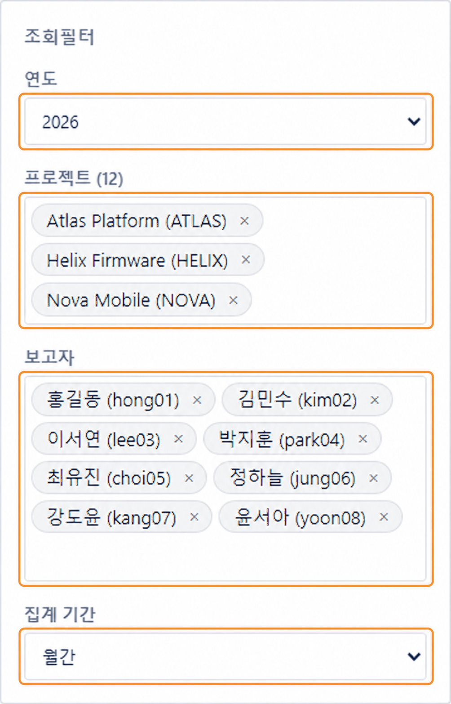
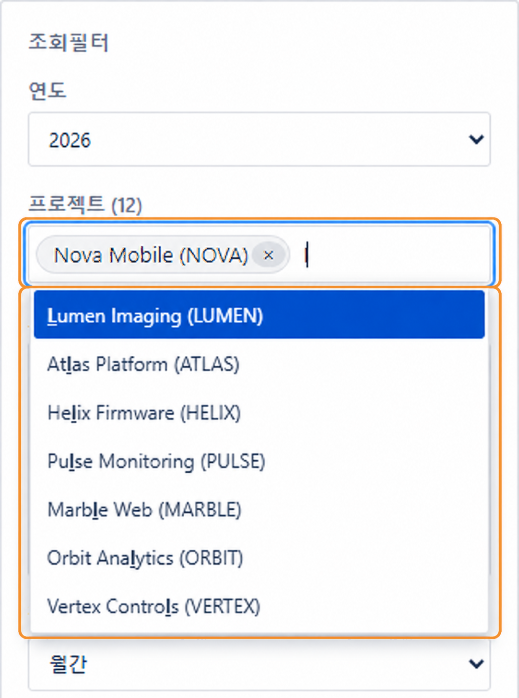
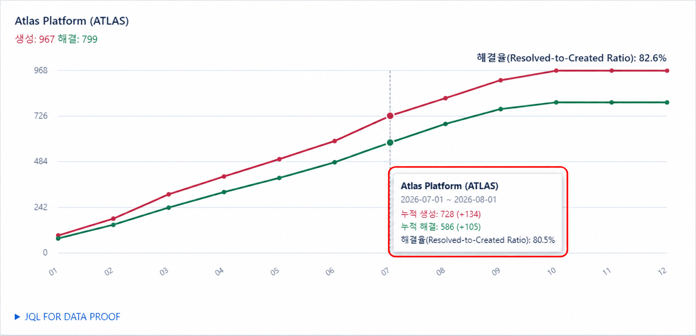
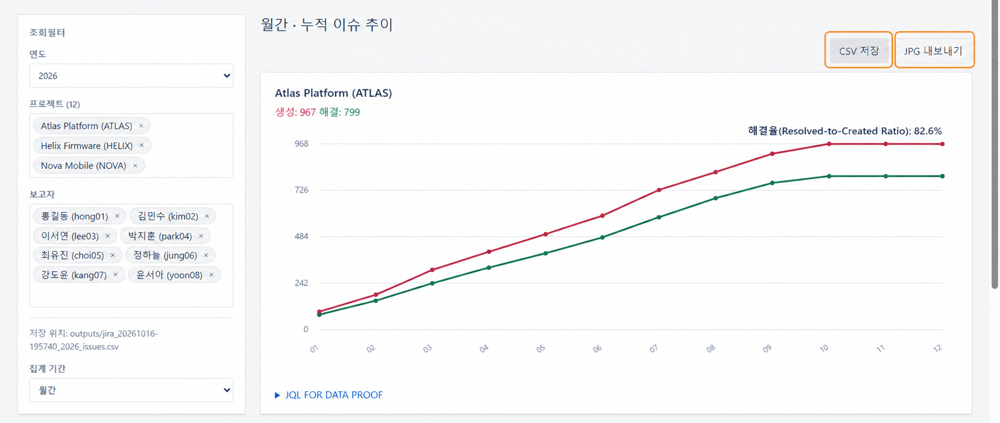

# jira_issue_meter

Local dashboard for Jira Server and Data Center issue trends.

<!-- showreel:start -->


The terminal scene is reconstructed from real console messages. The dashboard uses dummy data.
<!-- showreel:end -->

## Test environment

| Component | Version |
|---|---|
| Jira | JIRA Software Server 7.3 (on-premises) |
| OS | Windows 11 Pro 25H2, 26200.9711, 1000.26100.372.0 |

## Demo

```bat
demo.cmd
```

Opens the dashboard with fictional data. No Jira login needed.

<p align="center"></p>

## Quick start

Requires Windows, Git, and [uv](https://docs.astral.sh/uv/). Put `uv.exe` in `tools/` or add it to `PATH`.

```bat
git clone https://github.com/PARK4139/jira_issue_meter
cd jira_issue_meter
run.cmd --url {Jira-server-url} --id {Jira-user-id}
```

Enter your Jira password when prompted. The dashboard opens in your browser. Keep the terminal open; press **Ctrl+C** to stop.

<p align="center"></p>

## Read the graphs

Choose an output mode: **Cumulative**, **Non-cumulative**, or **Unresolved trend**. Choose **Separate graphs** or **Single graph** to compare selected projects together. In one graph, color identifies each project; dashed lines show Resolved. The guide below the graphs explains the selected mode.

<p align="center"></p>

<p align="center"></p>

<p align="center"></p>

## Export

Save report data as CSV or export the dashboard as JPG.

<p align="center"></p>

## Security

- The dashboard listens on this PC only (`127.0.0.1`).
- The Jira password stays in server memory and is not written to browser content, files, command arguments, or logs.
- HTTP does not encrypt credentials in transit. Use HTTPS for the Jira URL when available.
- Optional Auto login stores the Jira login in Windows Credential Manager after confirmation.
